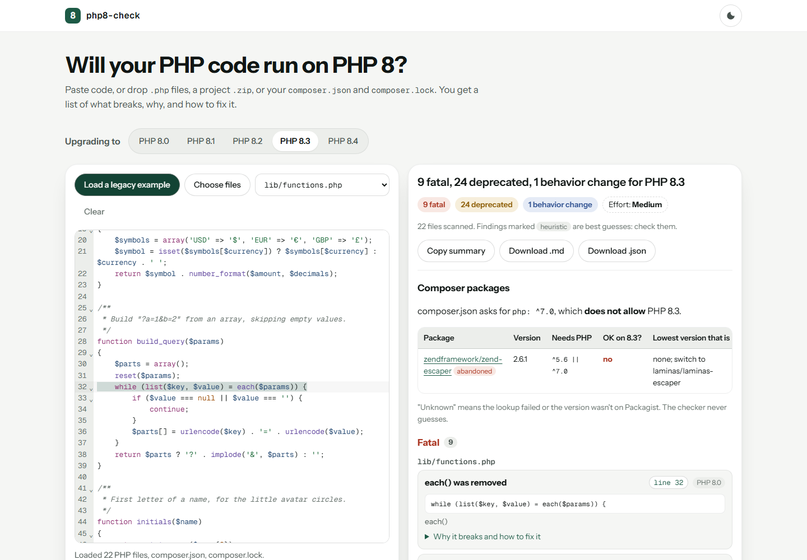

# php8-upgrade-kit

Your host moved to PHP 8 and now the site shows a white page. This repo has two
things for that moment. **php8-check** is a free web tool: paste your PHP code,
or drop a project zip or your `composer.json`, and it lists what breaks on PHP
8.0 to 8.4, why, and how to fix each one. It runs in your browser, so your code
never leaves your computer. **The walkthrough** is a small 2017-style PHP app
taken from PHP 7.2 to PHP 8.3 one commit at a time, with tests and CI proving
each step.

**[Open php8-check](https://hassan.im/php8-check/?utm_source=github&utm_medium=readme&utm_campaign=php8-upgrade-kit)** ·
[Read the walkthrough](walkthrough/README.md)



## What this covers

- **44 checks** taken from the official PHP migration guides: removed functions
  (`each()`, `create_function()`, `mysql_*`, `ereg`), syntax PHP 8 rejects
  (`$str{0}`, unbracketed nested ternaries, `(real)`), silent behavior changes
  (PHP 4 constructors, `0 == "abc"`), and the deprecations from 8.1 to 8.4
  (null passed to string functions, dynamic properties, `${var}` strings,
  missing return types, implicitly nullable parameters). Each finding comes with
  a plain-English explanation, a before/after fix and the PHP docs link. The full
  list is in [`tool/src/engine/rules/`](tool/src/engine/rules/).
- **Composer packages**: for each package in `composer.lock` it asks Packagist
  whether that version supports your target PHP, and the lowest version that does.
- **Exports**: a Markdown or JSON report, and a five-line summary you can paste
  into a job post.
- **A real upgrade, step by step**: [walkthrough/](walkthrough/README.md) starts
  with a test safety net, then runs this checker, PHPCompatibility, PHPStan and
  Rector, fixes what they leave behind one category per commit, removes an N+1
  query, and ends on PHP 8.3 with zero findings. Every step has a tag you can
  check out.

## What it can't do

A static scan reads code; it doesn't run it. Some problems only show up at
runtime, like a database column that is sometimes `NULL` reaching `htmlspecialchars()`. The
walkthrough shows one of these and how the tests caught it. Findings marked
*heuristic* are best guesses and can be wrong in either direction.

## Run it yourself

```sh
cd tool
npm ci
npm test        # every rule has a fixture that should match and one that shouldn't
npm run dev     # the web tool on http://localhost:5173
npx tsx src/cli.ts path/to/your/app --target 8.3 --composer --out report.md
```

Deploying the tool: [tool/DEPLOY.md](tool/DEPLOY.md). Adding a rule:
[CONTRIBUTING.md](CONTRIBUTING.md).

## License

MIT. All code and sample data in this repo were written for it.

---

Built by Ali Hassan · [github.com/alihassan](https://github.com/alihassan)
